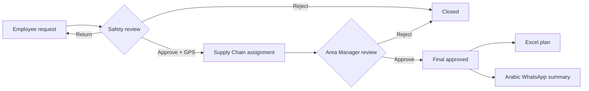
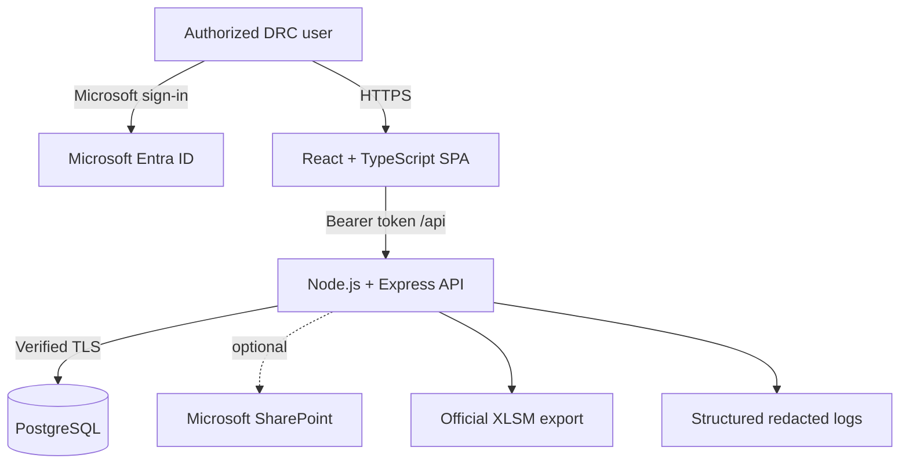

<p align="center">
  
</p>

<h1 align="center">DRC Movement Management System</h1>

<p align="center">
  Secure, auditable employee movement workflows from request to final approval.<br />
  <strong>نظام مؤسسي آمن لإدارة واعتماد حركات الموظفين</strong>
</p>

<p align="center">
  <a href="https://github.com/mohhdkh/drc-movement-system/actions/workflows/ci.yml"></a>
  
  
  
  
  
</p>

<p align="center">
  <a href="#overview">Overview</a> ·
  <a href="#workflow">Workflow</a> ·
  <a href="#architecture">Architecture</a> ·
  <a href="#getting-started">Getting started</a> ·
  <a href="#deployment">Deployment</a> ·
  <a href="#documentation">Documentation</a>
</p>

---

## Overview

The DRC Movement Management System is a full-stack internal application for planning, reviewing, assigning,
and approving employee movements. It replaces fragmented manual coordination with a role-based workflow,
authoritative audit history, operational conflict checks, and standardized outputs.

### Core capabilities

| Area | Capabilities |
| --- | --- |
| Employee | Create and edit multi-stop requests with per-segment passengers and a vehicle leader |
| Safety | Review requests, assign GPS devices, detect conflicts, reject, or return for modification |
| Supply Chain | Assign active vehicles and drivers with schedule-conflict prevention |
| Area Manager | Perform the final approval or rejection with server-owned audit data |
| Administration | Manage users, roles, master data, settings, and the administrative audit log |
| Operations | Export the official macro-enabled Excel plan and generate Arabic WhatsApp summaries |

## Workflow



The API is the authorization authority. Client-supplied status, approval metadata, and protected assignments
are never trusted.

## Architecture



| Layer | Technology |
| --- | --- |
| Client | React 19, TypeScript, Vite, React Router, MSAL |
| API | Node.js 24, Express 5 |
| Authentication | Microsoft Entra ID with local role authority |
| Data | PostgreSQL in production; SQLite for local development and migration tooling |
| Delivery | Multi-stage Docker image, free review and paid production Blueprints, GitHub Actions CI |
| Integrations | Microsoft Graph / SharePoint, official Excel workbook export |

## Quality and security

- 161 automated tests across client and server
- TypeScript build and Oxlint checks on every pull request
- Strict CORS allowlist, Helmet headers, JSON/content limits, and production rate limiting
- Cryptographic Entra access-token verification with bounded metadata retries
- PostgreSQL transactions, locking, conflict detection, and explicit schema migrations
- Redacted structured logging, request correlation IDs, and stable error envelopes
- Liveness, readiness, graceful shutdown, and pre-deploy migration controls
- Formula-injection protection in exported workbooks
- Production rejects development authentication, SQLite, insecure database TLS, and non-HTTPS origins

## Project structure

```text
.
├── .github/                 # CI, ownership, issue, and pull-request templates
├── client/                  # React + TypeScript application
├── server/                  # Express API, database, tests, and operations docs
├── doc/                     # Official movement-plan workbook templates
├── artifacts/               # Verified delivery artifacts
├── Dockerfile               # Production multi-stage image
├── render.yaml              # Free review-environment blueprint
├── render.production.yaml   # Paid production blueprint
└── PROJECT_SUMMARY.md       # Detailed Arabic project summary
```

## Getting started

### Prerequisites

- Node.js 24
- npm
- PowerShell examples below; equivalent commands work in other shells

### 1. Start the API

```powershell
cd server
npm ci
Copy-Item .env.example .env
npm run dev
```

### 2. Start the client

In another terminal:

```powershell
cd client
npm ci
npm run dev
```

Open `http://localhost:5173`. The local API defaults to `http://localhost:5000/api`.

> [!IMPORTANT]
> Never commit a populated `.env` file. Browser variables prefixed with `VITE_` are public and must never
> contain passwords, connection strings, or client secrets.

## Verification

```powershell
cd server
npm test

cd ../client
npm test
npm run lint
npm run build
```

Health endpoints:

| Endpoint | Purpose |
| --- | --- |
| `GET /api/health/live` | Confirms the Node.js process is responsive |
| `GET /api/health/ready` | Confirms PostgreSQL connectivity and migration readiness |
| `GET /api/health` | Compatibility health response |

## Deployment

The repository ships as one production container that serves the client and API from a single HTTPS origin.
This reduces cross-origin complexity and gives reviewers one canonical URL.

The included free `render.yaml` provides:

- Docker-based deployment from `main`
- automatic deploys only after GitHub checks pass
- a readiness health check before traffic is routed
- idempotent PostgreSQL migrations during review-environment startup
- graceful shutdown for zero-downtime rollout
- secret placeholders for PostgreSQL and Microsoft Entra configuration

It is intended only for review: Render can spin down a free service after inactivity, so the first request can
take about a minute. `render.production.yaml` keeps migrations in a separate pre-deploy phase and uses an
always-on paid compute plan for operational use.

Production requires PostgreSQL over verified TLS and a Microsoft Entra application registration. Follow the
[production runbook](server/docs/PRODUCTION_DEPLOYMENT.md) before sharing a live review link.

## Documentation

| Guide | Purpose |
| --- | --- |
| [Production deployment](server/docs/PRODUCTION_DEPLOYMENT.md) | Release, probes, security, observability, and rollback |
| [Microsoft Entra ID](server/docs/ENTRA_ID_SETUP.md) | Tenant, SPA redirect, API scope, and pilot checklist |
| [PostgreSQL setup](server/docs/POSTGRESQL_SETUP.md) | Schema, migrations, verification, and operational settings |
| [Backup and restore](server/docs/BACKUP_RESTORE.md) | Backup validation and recovery procedure |
| [SharePoint setup](server/docs/SHAREPOINT_SETUP.md) | Optional Graph and SharePoint integration |
| [Excel export](server/docs/EXCEL_MOVEMENT_PLAN_EXPORT.md) | Official workbook mapping and safety controls |
| [Arabic WhatsApp output](server/docs/ARABIC_WHATSAPP_OUTPUT.md) | Final-approved movement message format |
| [Project summary](PROJECT_SUMMARY.md) | Detailed Arabic functional and technical summary |

## Contributing and security

Read [CONTRIBUTING.md](CONTRIBUTING.md) before opening a pull request. Report vulnerabilities according to
[SECURITY.md](SECURITY.md), never through a public issue.

## Use and ownership

This repository does not grant an open-source license. It is intended for authorized internal review and use.
Do not redistribute operational data, credentials, or institutional configuration.
